# Agentic SOC Analyst

**A multi-agent LLM system that automates SOC triage, analysis, reporting and response.** Four specialized
AI agents turn raw security logs into a MITRE ATT&CK-mapped incident report and containment actions,
running entirely on a local GPU with no cloud API.

It started as an ENSI 4th-year project on automating a SOC analyst's work with a multi-agent system
(*« Système multi-agents IA pour l'automatisation des tâches d'un analyste SOC »*). It then grew three
extensions: adaptive learning from analyst feedback, an ELK integration, and a live sandbox. In the sandbox
the pipeline watches a real attack against a victim container and blocks the attacker with a real
`iptables` rule.

`Python 3.11 · LangGraph · LangChain` · `Ollama + Qwen 2.5 7B (local GPU)` · `ChromaDB (RAG)` ·
`FastAPI dashboard` · `Elasticsearch + Kibana 8.13` · `Docker Compose`

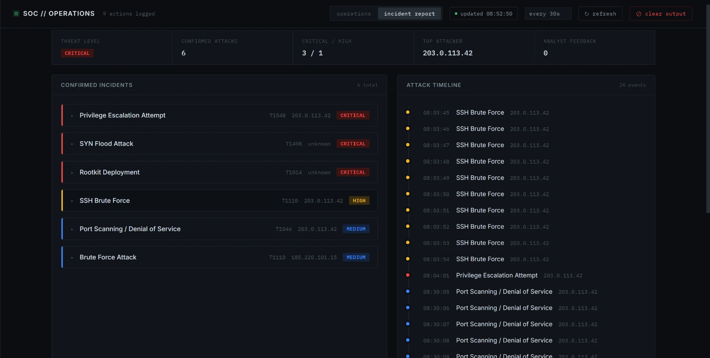

---

## Contents
- [What it does](#what-it-does)
- [One run, start to finish](#one-run-start-to-finish)
- [Screens](#screens)
- [The live attack sandbox](#the-live-attack-sandbox)
- [Architecture at a glance](#architecture-at-a-glance)
- [Project structure](#project-structure)
- [Tech stack](#tech-stack)
- [Run it](#run-it)
- [Design decisions](#design-decisions)
- [Known limits](#known-limits)
- [Roadmap / Future work](#roadmap--future-work)
- [Docs map](#docs-map)

---

## What it does

The full design is in [KING.md](KING.md). The build log and the reasoning behind it are in
[PAWN.md](PAWN.md).

- **Reads raw logs**: syslog-style lines from sshd, the firewall, Apache/mod_security, auditd and DNS.
  Logs come from the bundled dataset, from a file dropped into `src/data/incoming/`, from Elasticsearch, or
  live from a victim container.
- **Extracts events (Agent 1)**: a keyword pre-filter keeps benign lines away from the model. Regex then
  pulls timestamps, IPs and log levels, and the SLM returns structured JSON (event type, source IP, target,
  severity, summary).
- **Detects and correlates (Agent 2)**: it groups events by *(type, source IP)* into incidents and escalates
  severity with volume. Each incident is matched to a MITRE ATT&CK technique via RAG over ChromaDB.
- **Writes the incident report (Agent 3)**: an executive summary, an attack timeline, statistics and
  prioritized recommendations, with a per-incident analyst narrative grounded on a retrieved remediation
  playbook. The report is saved as `.txt` (for people) and `.json` (for the dashboard).
- **Responds (Agent 4)**: it maps each recommendation to an action: block IP, isolate host, rate-limit,
  notify admin, lock account, trigger forensics. Actions are simulated by default. With one flag, they run
  for real inside a disposable victim container. → [the live sandbox](#the-live-attack-sandbox)
- **Audits everything**: every action, simulated or real, is appended to a JSON-lines audit trail.
- **Learns from the analyst**: you can mark an incident *true* or *false positive* in the dashboard. Later
  incidents that look similar get that verdict injected into the analysis prompt.
- **Visualizes it**: a live two-tab dashboard (Operations / Incident report) polls the latest results.

---

## One run, start to finish

| | Bundled dataset | Live sandbox |
|---|---|---|
| Log lines read | 36 | 152 (victim `auth.log`) |
| Flagged by pre-filter | 29 | 148 |
| Incidents after correlation | 9 | 2 |
| Confirmed attacks | 6 (3 critical · 1 high · 2 medium) | 2 (SSH brute force, T1110) |
| Actions | 9 (simulated firewall/isolation + real admin notifications) | 2 real `iptables -A INPUT -s 172.20.0.8 -j DROP` → `exit=0` |
| Overall threat | CRITICAL | HIGH |

On an RTX 4060 laptop GPU (8 GB), Qwen 2.5 7B takes about 6.5 GB of VRAM. A full run on the bundled
dataset takes about **2 minutes** of model time.

On the labelled bundled dataset, the [experimentation report](https://github.com/user-attachments/files/29169172/Experimentation_Report.docx)
measured **96.6 % line-level classification accuracy (28/29)** and **100 % correct MITRE mapping on
confirmed incidents**, with no benign line raised as an attack. What it misses is listed under
[Known limits](#known-limits).

---

## Screens

**Operations**: action counters, severity breakdown, and the live audit feed.
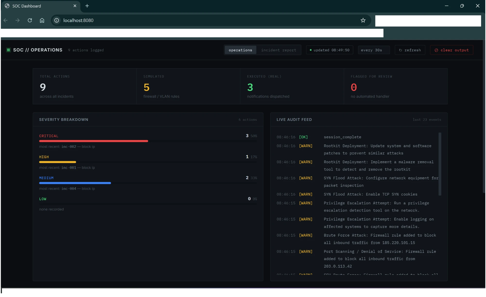

**Incident detail**: MITRE technique, confidence, the analyst narrative written by the model from the
retrieved playbook, the recommended action, and the true/false-positive buttons that feed adaptive learning.
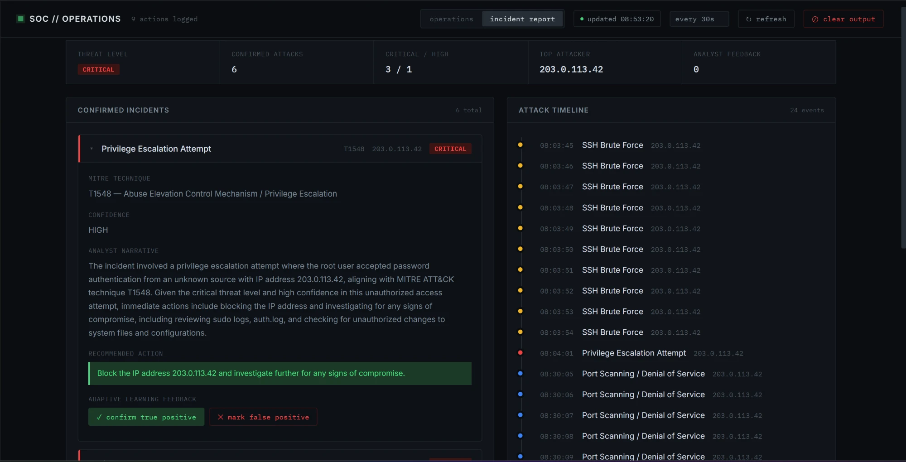

**Mitigations**: each action with the exact command, its target and its status.
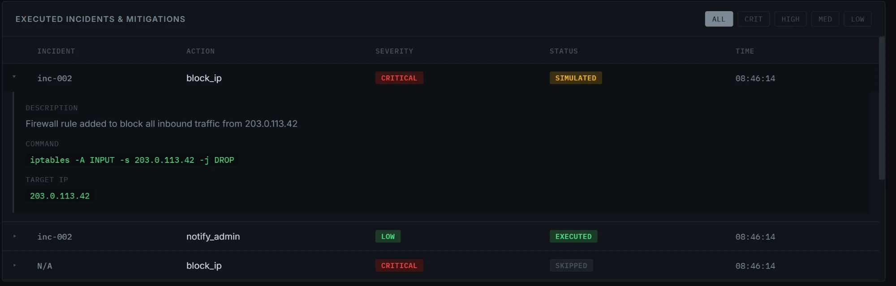

**Prioritized recommendations**: one per confirmed incident, ordered by severity.
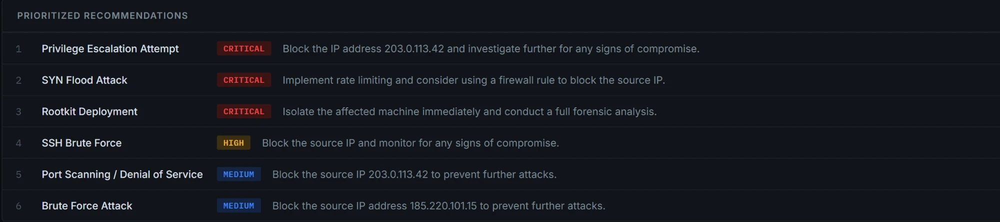

**The pipeline running**: the four agents in sequence (left), and the model on the GPU (right).
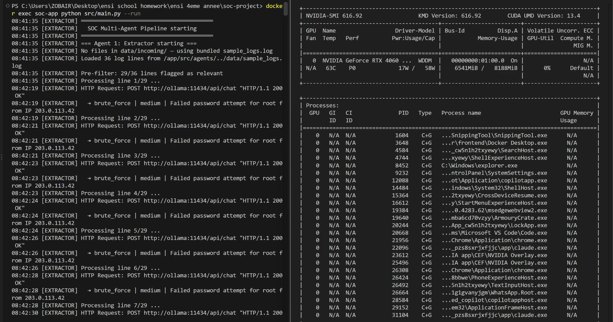

**The whole stack**: nine containers with the ELK and sandbox profiles enabled.
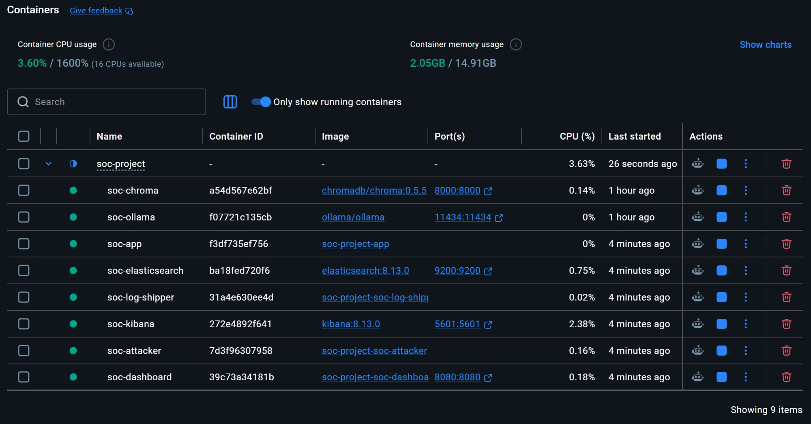

---

## The live attack sandbox

The sandbox is the most complete version of the project: a real target, real attack traffic, and a real
response.

```
 soc-attacker ──SSH brute force / port scan / SQLi──▶ soc-victim (Ubuntu: sshd, nginx, rsyslog)
                                                          │ /var/log (shared volume)
                              soc-log-shipper ◀───────────┤
                                     │                    ▼
                              Elasticsearch ──▶ Kibana    soc-app (LIVE_MODE): Extractor reads auth.log
                                                                     … Analyzer → Reporter → Executor
                                                                                        │
                                              iptables DROP inside soc-victim ◀─────────┘  (Docker SDK)
```

**1. The attack lands.** The attacker container brute-forces the victim's SSH. Each failed login is
shipped to Elasticsearch and appears in Kibana within seconds.
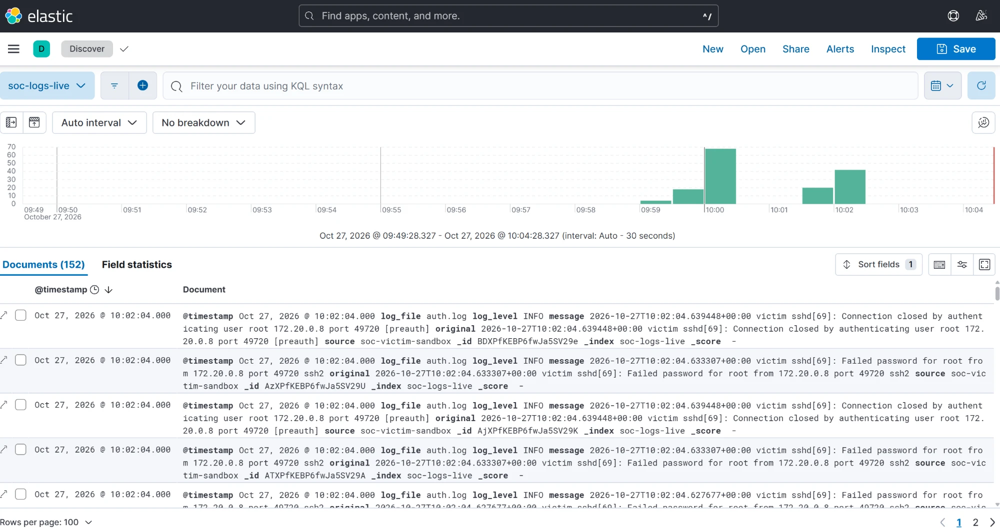

**2. The pipeline reads the victim's real logs.** In live mode the Extractor reads `auth.log` straight from
the victim instead of the sample file.
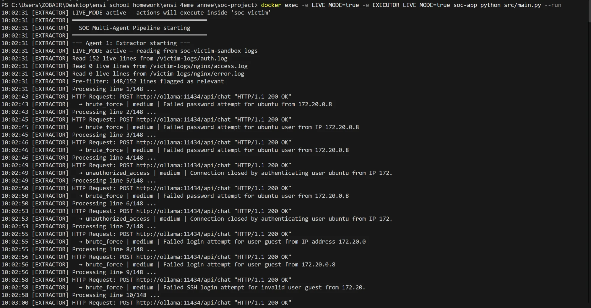

**3. It correlates and remembers.** 148 events collapse into the attacker's incident, mapped to T1110. The
analyst-feedback collection returns an earlier verdict for a similar incident.
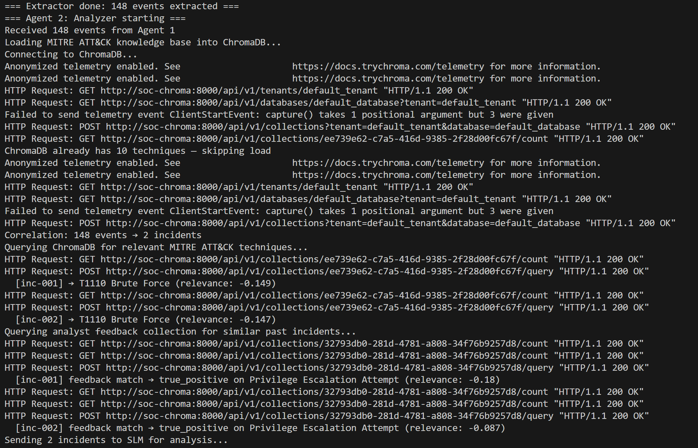

**4. It responds for real.** The Executor runs `iptables -A INPUT -s 172.20.0.8 -j DROP` inside the victim.
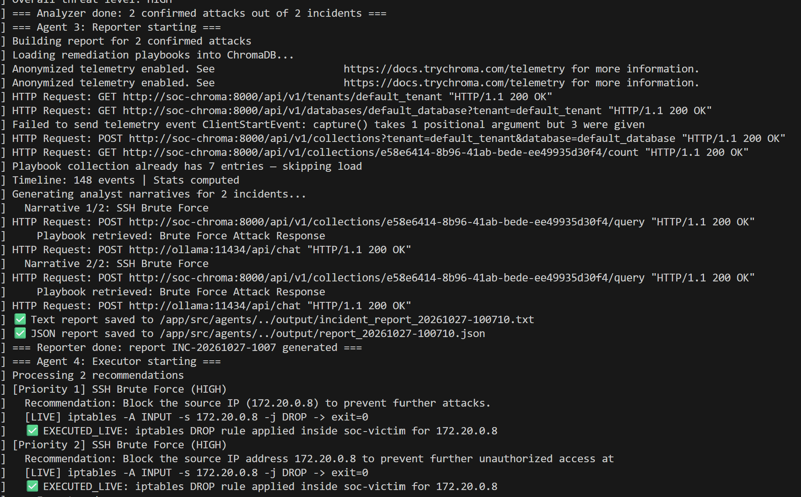

**5. The dashboard shows it**: the attacker as top source, and the actions as `EXECUTED_LIVE`.
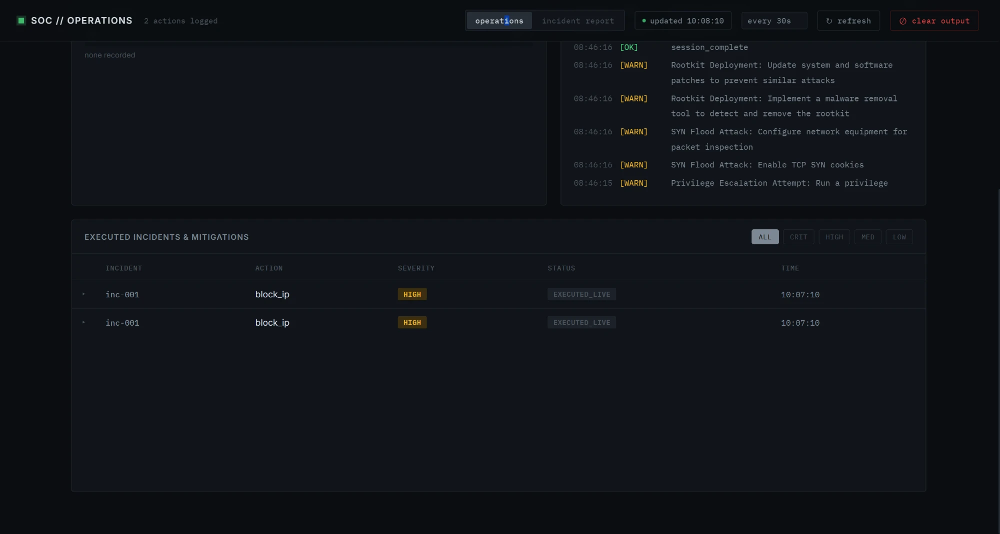
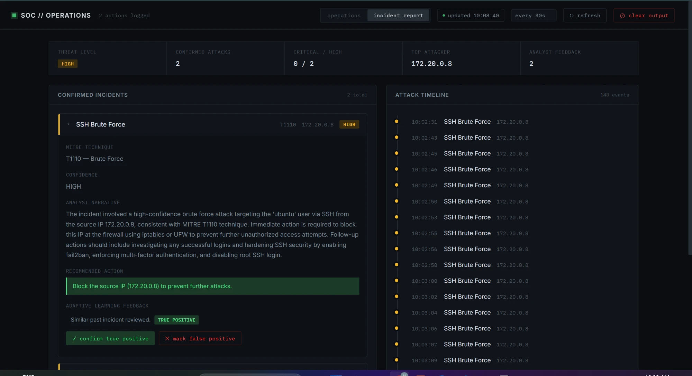

**How it stays safe**
- Real actions only ever run **inside `soc-victim`**, through the Docker SDK. Only that container gets
  `NET_ADMIN`, and the host's firewall is never touched.
- Each live handler returns exactly what its simulated version returns; only the `status` changes
  (`simulated` → `executed_live`). One environment variable switches everything back to simulation.
- The victim is **deliberately weak** (root password login), and its ports are never published to the host.
- The app container mounts the Docker socket so it can act on the victim. That's acceptable for a local
  lab, but a production version would use a narrowly scoped API instead.

---

## Architecture at a glance

```
 Log sources
   ├─ src/data/sample_logs.log  or the newest file in src/data/incoming/   (default)
   ├─ Elasticsearch index                                                  (ELK_MODE)
   └─ live victim container logs                                           (LIVE_MODE)
                          │
   LangGraph StateGraph: one PipelineState dict flows through four nodes
   Extractor ──▶ Analyzer ──▶ Reporter ──▶ Executor
     SLM          SLM + RAG      SLM + RAG     rule-based dispatch + SLM
                  (MITRE,        (playbooks)   (+ Docker SDK in live mode)
                   feedback)
                          │
   ChromaDB: mitre_attack (10) · soc_playbooks (7) · analyst_feedback (grows)
   Ollama: Qwen 2.5 7B on the GPU (one model, four system prompts)
                          │
   src/output/: report_*.json · incident_report_*.txt · actions_taken_*.json · audit_trail.log
                          │
   FastAPI dashboard (:8080) reads the latest files, polls every few seconds
```

| Container | Port | Profile | Role |
|---|---|---|---|
| `soc-ollama` | 11434 | baseline | Serves Qwen 2.5 7B with GPU acceleration |
| `soc-chroma` | 8000 | baseline | Vector store for the three RAG collections |
| `soc-app` | n/a | baseline | Runs the LangGraph pipeline (the four agents) |
| `soc-dashboard` | 8080 | baseline | FastAPI API and the dashboard page |
| `soc-elasticsearch` | 9200 | `elk` | Log storage and search |
| `soc-kibana` | 5601 | `elk` | Log exploration |
| `soc-victim` | n/a | `sandbox` | Ubuntu target with sshd, nginx and rsyslog |
| `soc-attacker` | n/a | `sandbox` | Generates attack traffic on a timer or on demand |
| `soc-log-shipper` | n/a | `sandbox` | Tails the victim's logs into Elasticsearch |

---

## Project structure

```
soc-project/
├─ src/
│  ├─ main.py                LangGraph pipeline: builds and runs the 4-node DAG
│  ├─ agents/
│  │  ├─ extractor.py        Agent 1: pre-filter, regex, SLM extraction; file / ELK / live sources
│  │  ├─ analyzer.py         Agent 2: correlation, MITRE RAG, feedback RAG, SLM analysis
│  │  ├─ reporter.py         Agent 3: timeline, stats, playbook RAG, narratives, .txt + .json
│  │  └─ executor.py         Agent 4: action dispatch, simulated / live handlers, audit trail
│  ├─ rag/
│  │  ├─ mitre_loader.py     10 ATT&CK techniques → ChromaDB
│  │  ├─ playbook_loader.py  7 remediation playbooks → ChromaDB
│  │  ├─ feedback_loader.py  analyst verdicts → ChromaDB (adaptive learning)
│  │  ├─ elk_ingest.py       one-shot ingest of the dataset into Elasticsearch
│  │  └─ elk_live_shipper.py tails the victim's logs into Elasticsearch
│  ├─ shared/memory.py       thread-safe shared memory with a write history
│  ├─ dashboard/             FastAPI backend (main.py) + single-page dashboard (index.html)
│  ├─ sandbox/
│  │  ├─ victim/             Ubuntu target: Dockerfile + entrypoint.sh
│  │  └─ attacker/           traffic generator: brute force, port scan, SQLi, bursts
│  ├─ data/                  sample_logs.log + incoming/ (drop-in datasets)
│  └─ output/                timestamped run artifacts (gitignored)
├─ scripts/trigger.sh        launch attacks on demand during a demo
├─ docker-compose.yml        baseline stack + `elk` and `sandbox` profiles
├─ Dockerfile                Python 3.11 app image
├─ KING.md                   architecture reference
└─ PAWN.md                   build log
```

---

## Tech stack

| Layer | Technology |
|---|---|
| Orchestration | LangGraph 0.2 (StateGraph DAG) · LangChain 0.2 |
| Model | Qwen 2.5 7B served by Ollama, on an NVIDIA GPU |
| Retrieval | ChromaDB 0.5.5 · all-MiniLM-L6-v2 embeddings (ONNX) |
| Response | Docker SDK for Python (live mode) |
| Logs | Elasticsearch 8.13 · Kibana 8.13 |
| Dashboard | FastAPI · Uvicorn · plain HTML/JS |
| Runtime | Docker Compose (WSL2 on Windows) · Python 3.11 |

---

## Run it

**Requirements:** Docker Desktop and an NVIDIA GPU (the compose file reserves one for Ollama). You also
need roughly 10 GB of free disk for images and the model.

**Baseline (bundled dataset):**
```bash
docker compose up --build -d
docker exec soc-ollama ollama pull qwen2.5:7b      # first time only, ~4.7 GB
docker exec soc-app python src/main.py --run
```
Then open **http://localhost:8080**. The first run also downloads a small embedding model (~80 MB). To
analyze your own logs, drop a `.log` or `.txt` file into `src/data/incoming/`. The newest file is used, with
no code change.

**ELK mode:**
```bash
docker compose --profile elk up -d
docker exec soc-app python src/rag/elk_ingest.py
docker exec -e ELK_MODE=true soc-app python src/main.py --run
```
Kibana is at **http://localhost:5601** (data view `soc-logs-live*`, time field `@timestamp`).

**Live sandbox:**
```bash
docker compose --profile elk --profile sandbox up --build -d
docker exec soc-attacker python3 -c "import generate_traffic as g; g.ssh_brute_force()"
docker exec -e LIVE_MODE=true -e EXECUTOR_LIVE_MODE=true soc-app python src/main.py --run
docker exec soc-victim iptables -L INPUT -n          # see the DROP rule
```
`docker restart soc-victim` clears the rule so you can run the demo again.

**Stop:**
```bash
docker compose --profile elk --profile sandbox down     # without -v, so the model is kept
```

---

## Design decisions

The full reasoning is in [PAWN.md](PAWN.md#decisions-worth-noting).

- **One model, four roles.** A single Qwen 2.5 7B serves every agent with a different system prompt. The
  agents differ by responsibility, not by weights, which keeps it deployable on one laptop GPU.
- **RAG instead of fine-tuning.** The model doesn't need to memorize ATT&CK IDs: the relevant technique
  descriptions are retrieved and placed in the prompt. The descriptions were rewritten in the vocabulary
  that appears in logs, which noticeably improved retrieval.
- **A LangGraph DAG, not nested chains.** The pipeline is an explicit graph with typed state. It is easy to
  follow, and it leaves room for conditional edges later.
- **Rule-based action dispatch.** The Executor maps recommendations to actions by keyword, not by asking
  the model. That is fast, deterministic and auditable. The model only proposes *extra* steps for critical
  incidents.
- **Simulated by default, real on a flag.** Every result is reproducible in simulated mode. Live mode is
  additive and can be reverted with one variable.
- **Docker SDK over an MCP gateway.** One app talking to one Docker daemon it already controls doesn't need
  a tool-server protocol.

---

## Known limits

- **Blocked attacks are under-rated.** On the bundled dataset, the SQL injection and the C2 DNS lookup were
  mapped to the right techniques (T1190, T1071), but the model didn't confirm them. Both were already
  blocked (`403`, `denied`), and the model seems to read "blocked" as "handled".
- **The correlation key is coarse.** Grouping by *(type, source IP)* can merge unrelated events when the IP
  is unknown.
- **One model call per flagged line.** Throughput scales with log volume: the 148-line live run spent about
  4 minutes in extraction. Batching lines would cut that sharply.
- **A small knowledge base.** 10 ATT&CK techniques, chosen to match the dataset, out of several hundred.
  Anything outside them can't be mapped.
- **Lab-grade sources.** There is no connector to a production SIEM or agent (Wazuh, Filebeat) yet.

---

## Roadmap / Future work

- **Batch extraction**: send several lines per model call to cut runtime on large logs.
- **Broader ATT&CK coverage**: load the full technique catalogue, not a curated ten.
- **Conditional graph edges**: skip the Executor on low threat, or loop back for low-confidence incidents.
- **Real ingestion**: Filebeat or Wazuh agents feeding Elasticsearch, in place of the static file.
- **Persistent shared memory**: Redis instead of in-process memory, so runs and instances can share state.

---

## Docs map

- **README.md** (this file): the front door, with the overview, screenshots, and how to run it.
- **[KING.md](KING.md)**: the **architecture reference**, with the containers, all four agents in detail,
  the RAG collections, the measured results and the known limitations.
- **[PAWN.md](PAWN.md)**: the **build log**, with what was built and when, what broke and how it was fixed,
  and the decisions worth noting.
- **[Experimentation report](https://github.com/user-attachments/files/29169172/Experimentation_Report.docx)**:
  detection accuracy, model performance (CPU vs GPU), limits and perspectives.

---

## License

Academic project (ENSI, 2025/2026). Not licensed for redistribution.
